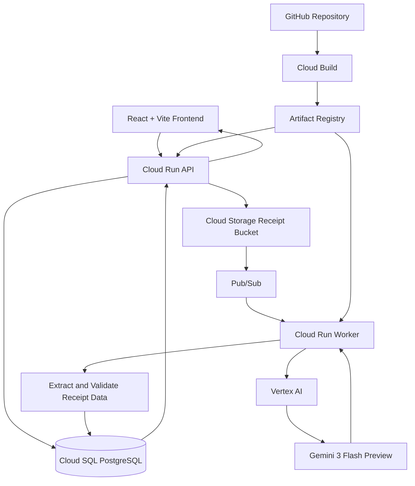

# AI Expense Analyzer — Generative AI on Google Cloud

An AI-powered expense management application that extracts information from uploaded receipts using **Google Vertex AI and Gemini**, compares the extracted details against user-entered expense records, and identifies mismatches for review. The application uses an event-driven processing pipeline and Google Cloud services for secure storage, asynchronous processing, deployment, and monitoring.

## Overview

Managing expenses manually can lead to incorrect amounts, merchant names, transaction dates, and categories. Verifying every receipt against an expense record is also time-consuming.

The **AI Expense Analyzer** addresses this problem by combining a web-based expense management application with Generative AI. Users can maintain expense records and upload receipts. The system processes receipt images asynchronously, extracts structured information using Gemini, and validates the extracted values against the corresponding expense records.

The application stores validation results so that users can identify verified expenses, mismatches, and records requiring further review.

## Key Features

- **Expense Management:** Create and manage expense records through a web application.
- **Receipt Upload:** Upload receipt images to Google Cloud Storage.
- **AI-Powered Receipt Extraction:** Use Vertex AI and Gemini 3 Flash Preview to extract structured receipt information, including merchant name, transaction date, amount, and category.
- **Automated Data Validation:** Compare AI-extracted fields against user-entered expense records.
- **Mismatch Detection:** Identify discrepancies between receipt information and saved expense data.
- **Asynchronous Processing:** Use Cloud Storage events and Pub/Sub to initiate background receipt processing without requiring the API to wait for the AI workflow to finish.
- **Persistent Results:** Store receipt analysis, validation status, and detected mismatches in PostgreSQL.
- **Cloud-Native Deployment:** Deploy the API and worker as separate Cloud Run services.
- **Automated CI/CD:** Use Cloud Build triggers connected to GitHub to build, test, package, and deploy the application.
- **Security and Observability:** Use IAM, Secret Manager, Cloud Logging, and Cloud Monitoring to support access control, credential management, and operational monitoring.

## Architecture



### Google Cloud Services Used

| Service | Purpose |
|---|---|
| **Cloud Run** | Hosts the backend API and the background receipt-processing worker as separate services. |
| **Cloud SQL** | Provides managed PostgreSQL storage for expenses, receipt analysis results, and validation details. |
| **Cloud Storage** | Stores uploaded receipt images securely. |
| **Pub/Sub** | Enables event-driven, asynchronous processing of uploaded receipts. |
| **Vertex AI** | Provides access to Google's generative AI capabilities. |
| **Gemini 3 Flash Preview** | Extracts structured information from receipt images. |
| **Artifact Registry** | Stores container images used for deployment. |
| **Cloud Build** | Automates builds, tests, container image publishing, and Cloud Run deployment. |
| **IAM** | Controls access to Google Cloud resources using service accounts and roles. |
| **Secret Manager** | Stores database credentials separately from application source code. |
| **Cloud Logging** | Collects application and deployment logs for troubleshooting. |
| **Cloud Monitoring** | Supports dashboards, metrics, uptime checks, and alerting. |

## End-to-End Workflow

### 1. Expense Creation

Users enter expense details through the React frontend. The backend API processes requests and stores the expense records in Cloud SQL PostgreSQL.

### 2. Receipt Upload

Users upload receipt images through the application. The backend uses Google Cloud Storage to store the receipt files.

### 3. Event-Driven Processing

A receipt upload generates a Cloud Storage object-finalization event that publishes a notification to Pub/Sub. The message initiates processing through the Cloud Run worker.

This architecture separates the receipt-processing workload from the main API, allowing AI processing to run asynchronously.

### 4. AI-Powered Extraction

The worker accesses the receipt and invokes Gemini through Vertex AI. The model extracts relevant information, such as:

- Merchant name
- Transaction date
- Total amount
- Expense category

The extracted response is handled as structured data for application-level validation.

### 5. Validation and Mismatch Detection

The application compares the extracted receipt values with the corresponding user-entered expense record.

For example, if the receipt indicates an amount of ₹345 but the saved expense record contains ₹17,499, the application can flag the amount discrepancy for review.

The application uses field-level comparisons to identify differences rather than treating the AI-generated extraction as the source of truth.

### 6. Results Storage

The extraction result, validation status, and detected mismatches are stored in Cloud SQL. The frontend can then display the verification outcome to the user.

### 7. Deployment and Monitoring

Cloud Build triggers connected to GitHub build and test the API and worker separately, publish their container images to Artifact Registry, and deploy them to Cloud Run.

Cloud Logging and Cloud Monitoring provide visibility into application behavior, errors, service metrics, and uptime.

## Validation Statuses

The application uses the following statuses to represent the outcome of receipt validation:

| Status | Meaning |
|---|---|
| `PENDING` | Receipt processing or validation has not yet completed. |
| `VERIFIED` | The extracted information matches the corresponding expense record according to the configured validation rules. |
| `MISMATCH` | One or more validated fields differ from the saved expense details. |
| `NEEDS_REVIEW` | The record requires further review rather than being treated as fully verified. |

## Technology Stack

**Frontend**
- React
- Vite
- Tailwind CSS

**Backend**
- Node.js
- Express.js
- TypeScript

**Database and Storage**
- PostgreSQL
- Google Cloud SQL
- Google Cloud Storage

**AI and Event-Driven Processing**
- Vertex AI
- Gemini 3 Flash Preview
- Google Cloud Pub/Sub

**DevOps and Security**
- Google Cloud Run
- Artifact Registry
- Cloud Build
- GitHub
- IAM
- Secret Manager
- Cloud Logging
- Cloud Monitoring

## CI/CD Pipeline

The project uses GitHub-connected Cloud Build triggers with separate build configurations for the API and worker.

The deployment workflow includes:

1. A code change is pushed to the configured GitHub branch.
2. The corresponding Cloud Build trigger starts.
3. Dependencies are installed and configured tests are executed.
4. The application is built and packaged into a container image.
5. The image is pushed to Artifact Registry.
6. Cloud Build deploys the new image to the corresponding Cloud Run service.

This approach makes deployments repeatable and keeps the API and receipt-processing worker independently deployable.

## Security Considerations

- Use dedicated service accounts for the API, worker, and deployment pipeline.
- Apply least-privilege IAM roles at the appropriate resource scope.
- Store database credentials in Secret Manager rather than committing them to source control.
- Keep receipt files in a private Cloud Storage bucket.
- Restrict access to backend services and cloud resources according to application requirements.
- Review application logs for errors while avoiding the exposure of credentials and sensitive data.

## Repository Structure

The repository separates the API, worker, and frontend responsibilities. The main components include:

```text
expense-analyzer/
├── frontend/                 # React + Vite user interface
├── backend/                  # Node.js + Express API
│   └── cloudbuild.yaml       # API build and deployment configuration
├── worker/                   # Asynchronous receipt-processing worker
│   └── cloudbuild.yaml       # Worker build and deployment configuration
└── README.md
```

*Note: Adjust the frontend path or other entries if your actual repository uses a different directory structure.*

## Local Development

### Prerequisites

- Node.js and npm
- A Google Cloud project with the required APIs enabled
- Access to the configured Cloud SQL PostgreSQL database
- A configured Cloud Storage bucket and Pub/Sub integration
- Appropriate permissions for Vertex AI and the required Google Cloud resources

### Setup

1. Clone the repository.

   ```bash
   git clone https://github.com/Balajisix/expense-analyzer.git
   cd expense-analyzer
   ```

2. Install dependencies separately in the frontend, backend, and worker directories, using the package manager and scripts defined in each component.

3. Configure the required environment variables for the database connection, receipt storage, and AI-processing workflow. Use local environment files or Secret Manager as appropriate.

4. Configure Google Cloud authentication and permissions for the resources accessed by the application.

5. Start each component using its documented development scripts.

**Important:** The exact commands and required environment variable names depend on the scripts and configuration included in each component. Do not commit `.env` files, service-account keys, access tokens, or database passwords to GitHub.

## Learning Outcomes

This project provided practical experience with:

- Building and deploying cloud-native applications on Google Cloud.
- Integrating Generative AI into a business workflow using Vertex AI and Gemini.
- Implementing event-driven architecture with Cloud Storage and Pub/Sub.
- Separating synchronous API requests from background processing.
- Managing application data with Cloud SQL and storing files in Cloud Storage.
- Automating container builds and deployments using Cloud Build and Artifact Registry.
- Applying IAM and Secret Manager for access control and credential management.
- Troubleshooting production-style issues using Cloud Logging and Cloud Monitoring.

## Future Enhancements

- Add confidence-aware extraction and configurable validation tolerances.
- Introduce retry policies and a dead-letter workflow for failed receipt processing.
- Add stronger duplicate-receipt detection and idempotent event handling.
- Improve validation rules for currencies, taxes, and partially readable receipts.
- Extend analytics and reporting for expense patterns and spending trends.

---

**Project:** AI Expense Analyzer  
**Focus:** Generative AI, Cloud-Native Application Development, Event-Driven Architecture, DevOps, Security, and Monitoring  
**Cloud Platform:** Google Cloud Platform (GCP)
